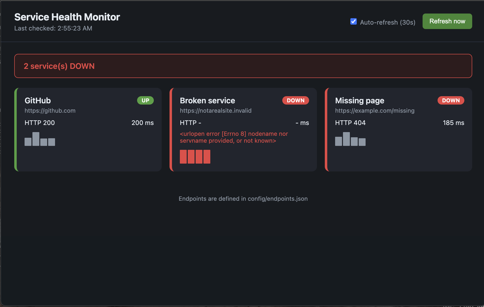

# Service Health Monitor

A monitoring tool that checks web endpoints, classifies each as UP, SLOW or DOWN, shows them on a live dashboard and writes a Markdown incident report. It runs on every push and on weekday mornings through GitHub Actions.

## Features
- Live web dashboard with status cards and response-time history
- Configurable endpoints, expected status codes and slow thresholds
- Exit code 1 when anything is DOWN, so pipelines can fail on it
- Unit tests and a scheduled CI workflow
- Incident runbook in docs/runbook.md
- No dependencies: Python 3 standard library only

## Usage

    python3 monitor.py                                # command-line check
    python3 server.py                                 # dashboard at http://127.0.0.1:8000
    python3 server.py 8000 config/demo-failure.json   # dashboard with failures
    python3 -m unittest discover -s tests -v          # run the tests

## Configuration

Endpoints live in config/endpoints.json. Each has a name and url, with optional expected_status (default 200) and slow_ms (default 1000).

## Author

Shah Malik - IT Support Analyst
